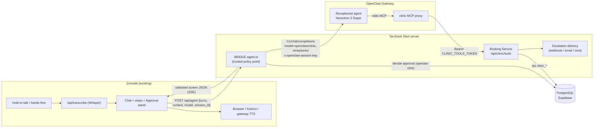

# OpenClaw Voice & Spatial Console (`living-ai-talk`)

A DarkCoders voice, chat, and 3D WebXR console designed for multi-agent orchestration on **OpenClaw**.

> **Candidates:** Read **[`ASSIGNMENT.md`](./ASSIGNMENT.md)** for full assignment instructions, architecture integration points, and deliverables.

---

## What was built: a Clinic Reception voice agent

A voice receptionist for one dental clinic with **two branches** (Mokattam and
Maadi), **one dentist each**. It books, reschedules and cancels dental
appointments in Egyptian Arabic by voice.

The design rule is one sentence: **the LLM understands and speaks, deterministic
code decides and executes, and a human approves anything that changes a booking.**

- **NVIDIA Nemotron 3 Super** runs inside the OpenClaw agent `clinic-receptionist`
  (console model string `openclaw/clinic-receptionist`), with Gemini 3.8 Flash
  configured only as the failover for provider errors and 429s.
- A **deterministic Booking Service** (TypeScript + PostgreSQL functions)
  executes every state change; the model never writes to the database.
- The **`/api/agent` bridge** is the trusted policy point: it opens the session,
  injects the clinic context, intercepts the Approve/Deny click, validates and
  repairs the model's JSON, and attaches the approval proposal **from the
  database** rather than from the model.
- **13 tools** are exposed over an MCP stdio proxy and verified by
  `npm run clinic:mcp-smoke`. Two of them exist because there is no branch in the
  server environment: `select_branch` (the caller picks the branch in
  conversation) and `find_doctor` (the caller names a dentist and learns which
  branch he works at, without guessing from context).

Design details, data model and contracts live in [`docs/ARCHITECTURE.md`](docs/ARCHITECTURE.md);
the build prompts are in [`docs/PROMPTS.md`](docs/PROMPTS.md).

### Architecture



### The calls made, and why

- **Deterministic booking, no second LLM.** Scheduling is plain TypeScript plus
  SQL functions, so there is no hallucination surface between "the caller picked
  4pm" and "the database holds 4pm".
- **The database is the source of truth for double-booking.** `EXCLUDE USING gist`
  constraints on doctor and patient time ranges make an overlap impossible even
  under concurrent calls — not merely unlikely.
- **Two-phase booking.** `hold_slot` (auto, 180 s TTL, reversible) → read back →
  `request_approval` → the operator's click in the panel → `confirm_booking`,
  which re-validates and consumes the approval in one transaction.
- **Approvals are generated and verified by the database.** The approval id,
  title, summary and risk level are written by SQL; the model may only relay
  them, and the bridge overwrites `action_proposal` from the newest pending row
  so the panel can never show a model-invented action.
- **The caller's "yes" is not enough.** Approval is a second, authenticated
  channel (the panel), because verbal consent alone must not authorise a write.
- **Emergency is the one bypass.** `escalate_to_human` is notify-only, cannot
  change a booking, and is logged; the agent never says "I transferred you"
  unless the tool returned `status: "connected"`. With no telephony in this
  build it falls back to a webhook and reports the *real* delivery status.
- **Structured errors carry the next move.** Every failure returns `code`,
  `retryable` and an `agent_action` (`ask_again`, `offer_alternatives`,
  `restart_hold`, `explain_policy`, …) so the agent behaves predictably instead
  of improvising.
- **Secrets stay server-side.** `NVIDIA_API_KEY` lives in the gateway (with
  `GEMINI_API_KEY` only for the fallback), `CLINIC_TOOLS_TOKEN` in the server and
  the proxy, `SUPABASE_SERVICE_ROLE_KEY`
  only on the server. Nothing secret enters a prompt, the browser bundle or git.

### Where AI tools helped

- The architecture plus the ten build prompts (`docs/PROMPTS.md`) were used as
  standing instructions for the coding agent, which is how the parts stayed in
  the order they depend on each other.
- The SQL schema, functions and smoke test were drafted with AI assistance and
  then reviewed against the written contracts before being trusted.
- AI tooling also wrote most of the first draft of the deterministic service, the
  bridge and the MCP proxy — and introduced the defects this session had to
  repair: an E.164 normaliser that kept the Egyptian trunk zero, a bearer-token
  placeholder that silently broke every tool call, a truncated agent prompt with
  no output contract, and a booking service that did not compile. That is the
  honest picture: the tooling is fast at drafts and unreliable at details, so
  every claim in this repo is backed by a command you can rerun.

---

## How to run

```bash
npm install
npm run typecheck && npm test      # 0 errors, 35 passing tests
cp .env.example .env               # Supabase, CLINIC_TOOLS_TOKEN, gateway URL
```

1. **Database** (PostgreSQL 15+ with `postgresql-contrib` for `btree_gist`):
   ```bash
   psql "$DATABASE_URL" -v ON_ERROR_STOP=1 -f supabase/migrations/20261015120000_clinic_reception.sql
   psql "$DATABASE_URL" -v ON_ERROR_STOP=1 -f supabase/seed_clinic_demo.sql
   psql "$DATABASE_URL" -v ON_ERROR_STOP=1 -P pager=off -f supabase/tests/clinic_smoke.sql   # -> == ALL CHECKS PASSED
   ```
   `supabase/reset_demo.sql` clears call data between runs, keeping the clinic.
2. **Console**: `npm run dev`, then Settings → Models → *Clinic receptionist ·
   Nemotron 3 Super*, and Settings → Voice & Agents → agent *Clinic receptionist*
   with an Arabic ASR/TTS choice.
3. **OpenClaw**: merge `openclaw/openclaw.json5` into
   `~/.openclaw/openclaw.json`, install the MCP proxy deps, and put
   `NVIDIA_API_KEY` in the gateway environment. See [`openclaw/README.md`](openclaw/README.md).
4. **Check it before you demo**: `npm run clinic:preflight` — it verifies env,
   database, gateway, agent, tools and speech and reports `UNVERIFIED` rather
   than guessing. [`docs/TESTING.md`](docs/TESTING.md) is the full human script.

### Key scripts

- `npm run dev` — Vite + TanStack Start dev server
- `npm run build` — client, SSR and Nitro server bundles
- `npm run typecheck` — `tsc --noEmit`
- `npm test` — `node --test`
- `npm run clinic:preflight` — pre-demo readiness checks
- `npm run clinic:webhook-echo` — local escalation receiver for testing
- `npm run clinic:mcp-smoke` — asserts the MCP proxy's 13-tool set over stdio
- `npm run lint` — ESLint

### Architecture reference

- **`ASSIGNMENT.md`** — candidate challenge brief, requirements, grading rubric
- **`docs/ARCHITECTURE.md`** — clinic agent design, data model, tool contracts
- **`docs/TESTING.md`** — the human test script, Arabic phrases, SQL checks
- **`src/routes/api/agent.ts`** — the bridge: session, approvals, validation, proposal
- **`src/routes/api/clinic/tools.ts`** — the Booking Service HTTP endpoint
- **`src/lib/clinic/`** — contracts, phone normalisation, RPC, tools, escalation
- **`supabase/migrations/20261015120000_clinic_reception.sql`** — schema, functions, grants
- **`openclaw/`** — agent prompt, skills, MCP proxy and the console config fragment
- **`src/config/unified-plan.yaml`** — the original `VoiceChatOpenClawArchitecture` spec
- **`src/lib/settings/voice.ts`**, **`src/lib/voice/screen.ts`** — agent roster and screen parser

---

## Known limits

The full list is `docs/ARCHITECTURE.md` §10. The ones that matter for a demo:

- The **Approve click is a chat message**. Anyone who can type the exact
  `Approved action [apr_…]` string with a valid id could approve; the database
  still checks session, state, expiry and single use. The upgrade path is a
  signed `/api/clinic/approvals/decide` endpoint instead of text.
- **`session_id` is a bearer value** (a browser UUID) passed to tools via
  context. Production should use signed session tokens or the OpenClaw session key.
- **Name + phone is weak identity**, which is why changes are approval-gated and
  no medical data is stored.
- **No SIP in this build**, so `live_transfer` cannot connect and the service
  falls back to notify and says so.
- The demo seed's **phones and emails are placeholders** (`example.invalid`);
  replace them before trusting any escalation.
- Not a medical device: no advice is given and no medical data is stored.

## Verified vs not verified

**Verified in this checkout:** `npm run typecheck` (0 errors) and `npm test`
(38/38) pass; `npm run build` succeeds and regenerates the route tree; the MCP
proxy answers the MCP handshake and lists exactly the 13 expected tools
(`npm run clinic:mcp-smoke`), refuses to start without its env, and sends the
bearer token; the three prompt files are byte-identical to `docs/PROMPTS.md`;
the webhook echo receives an escalation and answers 200.

**Not verified here — needs a person at the machine:** the SQL smoke test
(`== ALL CHECKS PASSED`), because no PostgreSQL was available in this
environment, and everything needing the OpenClaw gateway or an NVIDIA key: the
agent's real replies, `x-openclaw-session-key` semantics, whether `messages`
history merges with the stored session, Whisper transcription and Arabic TTS
quality. The exact commands for all of these are in
[`docs/TESTING.md`](docs/TESTING.md) §8.
