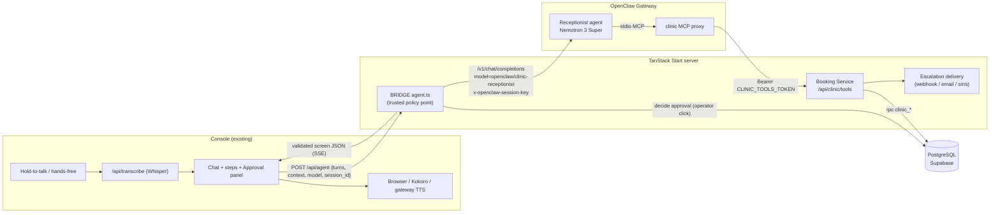
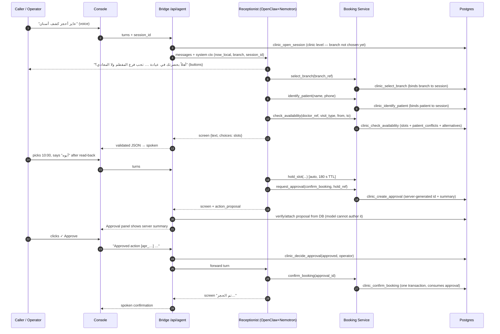
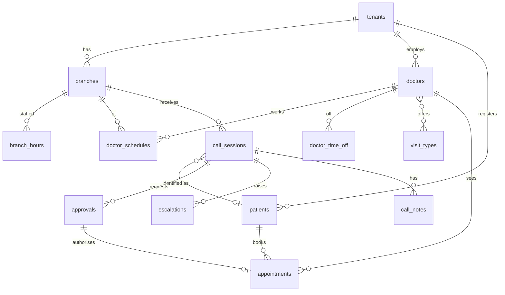

# Clinic Reception Voice Agent — Architecture

Demo setup: **one dental clinic, two branches (Mokattam, Maadi), one dentist per branch**. The agent knows it is speaking for this clinic and asks the caller which branch they want. More clinics can be added later as data (multi-tenant schema is kept).

Built for the Dark Coders "AI & Agent Engineering" take-home (`living-ai-talk` console, OpenClaw).
Reasoning/answer model: **NVIDIA Nemotron 3 Super** (`nvidia/nvidia/nemotron-3-super-120b-a12b` via build.nvidia.com) running inside an OpenClaw agent, with **Gemini 3.8 Flash** (`google/gemini-3.8-flash`) configured only as the failover for provider errors and 429s.
Database: **PostgreSQL** (the repo already ships Supabase = Postgres, so the schema is a Supabase migration).

---

## 0. What the repo actually gives us (read from the code, not assumed)

| Fact | Where | Consequence for us |
|---|---|---|
| The console POSTs `{turns, context, model}` to `/api/agent`. `turns` = last 12 `{role,text}` only. No session id, no tenant. | `src/routes/api/agent.ts`, `src/lib/voice/agent.ts` | We must add a `session_id` (client UUID) — the only way to bind identity/approvals server-side. |
| Non-`openai/*` models go through `streamChatAsResponses` → OpenClaw `POST /v1/chat/completions`, re-emitted as Responses-style SSE. | `src/lib/ai/responses.server.ts` | Our agent is reached as `model: "openclaw/clinic-receptionist"`. |
| On that path the JSON **schema is never sent** (only `SYSTEM_PROMPT` + "reply with only the JSON object"). `OUTPUT_FORMAT` is used only for `openai/*`. | `responses.server.ts`, `prompt.ts` | The agent prompt must embed the exact JSON shape, and the bridge must validate + repair. |
| Console only accepts `{kind:"screen", screen:{text, choices≤4, navigation}, action_proposal, app_commands≤3}`. Invalid → safe error screen. Choice id `^[a-z][a-z0-9_]{0,31}$`, label ≤40, value ≤1000; proposal id ≤64, title ≤120, tool ≤80, summary ≤500. | `src/lib/voice/screen.ts` | Shapes in §6 respect these limits. |
| Approve/Deny is **just a user message**: `Approved action [<id>] (<title> via <tool>). Proceed and report the result.` / `Denied action [<id>] (<title>). Do not execute.` | `src/routes/index.tsx` (`onDecideProposal`) | Text alone must never authorise anything → server-side approval state (§5). |
| Blueprint: approval must be external to the model, bound to exact action, single-use, expiring; verbal "yes" alone is insufficient; connectors must never simulate results; secrets never in prompts. | `src/config/unified-plan.yaml` | These are the rules we implement. |
| `GATEWAY_MODELS` allowlist names neither model the clinic agent runs on; unknown names return 400; `openclaw/*` passes through; `undefined` model silently becomes `gpt-6-astra`. | `src/lib/ai/models.ts` | Pick the model in the OpenClaw agent config; console sends `openclaw/clinic-receptionist`. |
| Supabase is optional (`user_state` only), server client `supabaseAdmin` (service role). No other DB. | `supabase/`, `client.server.ts` | Add one migration; call SQL functions via `supabaseAdmin.rpc`. |
| Tests: `node --test` on an explicit file list; tests excluded from `tsc`; strict TS incl. `exactOptionalPropertyTypes`, `noUncheckedIndexedAccess`. | `package.json`, `tsconfig.json` | New tests must be appended to the `test` script. |

OpenClaw facts (from docs.openclaw.ai, verify against your installed version): chat-completions endpoint must be enabled (`gateway.http.endpoints.chatCompletions.enabled`); `model: "openclaw/<agentId>"` selects an agent; `x-openclaw-session-key` / OpenAI `user` controls session; `x-openclaw-model` can override the backend model; config lives in `~/.openclaw/openclaw.json`; custom tools come from **MCP servers** (`mcp.servers`) or plugins; skills are `SKILL.md` files injected into the system prompt; `tools.allow/deny` (deny wins).

---

## 1. Design principle

> **The LLM understands and speaks. Deterministic code decides and executes. A human approves anything that changes a booking.**

* No booking is ever described to the caller as done before the database function returned `ok` and `status: "booked"`.
* There is **one** LLM (the receptionist). The "Booking Service" and "Escalation Service" are plain functions — not agents — so scheduling has zero hallucination surface. (Same principle as your A1 design: no second LLM for booking.)
* One logical agent definition per tenant/branch (persona, knowledge, toolset). In this build only the console channel exists; the thin "channel adapter + style layer" idea from A1 is kept as the boundary: the bridge converts console I/O ↔ the common message format, and the prompt's voice-style rules are the style layer.

---

## 2. Components



| Component | Type | Responsibility | May write DB? |
|---|---|---|---|
| **Receptionist** (OpenClaw agent) | LLM | Understand, ask one question at a time, call tools, phrase replies, emit the screen JSON. | No (only via tools) |
| **Booking Service** | Deterministic (TS + SQL functions) | Availability, holds, approvals, confirm/reschedule/cancel (atomic), notes, escalation record. | Yes |
| **Escalation Service** | Deterministic | Pick route (live transfer vs notify), deliver, report the *real* delivery status. | Yes (status) |
| **Bridge** (`/api/agent`) | Deterministic, trusted | Session open, context injection, approval click → DB, output validation/repair, attaches `action_proposal` from DB. | Yes (approval decision, audit) |
| **MCP proxy** | Thin stdio process | Exposes tool schemas to OpenClaw; forwards to Booking Service with a service token. | No |

Optional red-flag screening is **a prompt rule + the `escalate_to_human` tool**, not a separate agent (don't over-engineer).

---

## 3. Data flow

### 3.1 Booking (happy path, Approval gate included)



### 3.2 Failure paths (all return the real error — never fake data)

* **Slot taken between offer and hold** → `SLOT_UNAVAILABLE` → agent re-runs `check_availability`, offers alternatives.
* **Caller already has an overlapping appointment** → `PATIENT_CONFLICT` (+ conflicting appointment) → agent says so and offers reschedule/alternatives.
* **Hold expired before approval** → `HOLD_EXPIRED` → restart hold.
* **Approval denied / expired / replayed** → `APPROVAL_DENIED` / `APPROVAL_EXPIRED` / `APPROVAL_ALREADY_USED` → agent stops, never retries with the same id.
* **DB or network error** → `DB_ERROR` / `UPSTREAM_TIMEOUT` (retryable once) → apology + offer human handoff.
* **Model returns invalid JSON** → bridge repairs once, else safe error screen ("last confirmed state is unchanged").

### 3.3 Escalation

```mermaid
flowchart TD
  T[Red flag / out of scope / policy block / caller asks for a human] --> E[agent calls escalate_to_human]
  E --> R{clinic_escalate:\nwithin branch hours?}
  R -- yes --> L[route = live_transfer]
  R -- no  --> N[route = notify_contact]
  L --> D1[attempt transfer\n(SIP not available in this build)]
  D1 -- unavailable --> N
  N --> D2[webhook / email / sms\nwith summary + caller details]
  D2 --> S{delivery result}
  S -- ok --> OK[status = notified/connected]
  S -- error/not configured --> FAIL[status = delivery_failed + error]
  OK & FAIL --> SAY[agent speaks the TRUE status\n+ emergency number + clinic phone]
```

Emergency escalation is the **one action that bypasses the approval gate**: it is notify-only, cannot change a booking, and delay is the greater harm. It is still logged, and the agent never claims "I transferred you" unless `status = "connected"`.

---

## 4. Patterns used (and why)

| Pattern | What it means here |
|---|---|
| **Deterministic executor** | Every state change = one `clinic_*` SQL function = one transaction. |
| **Constraint-enforced integrity** | `EXCLUDE USING gist` on doctor and on patient time ranges: double-booking is impossible even under concurrent calls (tested: 20 simultaneous races, exactly one winner each). |
| **Two-phase booking** | `hold_slot` (auto, reversible, 180 s TTL) → read-back → approval → `confirm_booking`. |
| **Propose → Park → Approve → Execute** | Model asks via `request_approval`; DB stores a pending row bound to exact params; only the bridge flips it on the operator click; execution tools re-validate and consume it (single use, 10 min expiry). |
| **Model relays, never authors** | Approval id, title, summary, risk are generated by the DB; the bridge attaches the proposal from DB. The model cannot misdescribe an action in the panel. |
| **Server-side identity binding** | `identify_patient` binds `patient_id` to the session in the DB. Tools never accept a patient id from the model; appointments are addressed by short `appointment_ref` (confirmation code), scoped to that patient. |
| **Server-formatted speech fields** | Tools return `local.spoken_ar / spoken_en / weekday_ar / time_24` computed in SQL with the branch's IANA timezone (Egypt has DST). The model never does date/timezone arithmetic for output. |
| **Structured error envelope + `agent_action`** | Every failure has `code`, `retryable`, and a recommended next behaviour (§6.3). |
| **Least privilege** | OpenClaw agent: tools allow-list = clinic MCP only; `exec`, `process`, fs write, browser, etc. denied. DB: RLS on, no policies, no anon/authenticated grants, functions executable by `service_role` only. |
| **Data minimisation** | No medical data stored. Name + phone + appointment only. No prices unless configured. |
| **Audit** | `audit_events` (append-only) for every tool call, approval decision, escalation. |

---

## 5. Autonomy tiers

| Tier | Tools | Behaviour | Approval |
|---|---|---|---|
| **T0 Read** | `get_clinic_info`, `check_availability`, `list_my_appointments` | Run immediately | none |
| **T1 Reversible write** | `select_branch`, `identify_patient` (find-or-create), `hold_slot`, `add_note` | Run immediately; caller told what is saved (name+phone) | none (hold auto-expires) |
| **T2 Consequential write** | `confirm_booking` (risk `low`), `reschedule_appointment`, `cancel_appointment` (risk `medium`) | `request_approval` first | **Panel Approve** (branch flag `require_booking_approval=false` lets *bookings only* rely on the caller's verbal confirmation) |
| **T3 Policy-blocked** | change/cancel inside `cancel_cutoff_hours` | `OUTSIDE_POLICY` → explain → offer human handoff | — |
| **T4 Safety** | `escalate_to_human` | Immediate, notify-only | bypass (logged) |
| **Denied by default** | shell, files, browser, anything outside the clinic MCP | not exposed | — |

Two layers of consent: the caller's verbal "yes" after read-back (caller intent), **and** the operator's click (authenticated channel — verbal confirmation alone is insufficient per the blueprint).

---

## 6. Contracts

### 6.1 Tool envelope (Booking Service → MCP → model)

```ts
type AgentAction =
  | "ask_again" | "offer_alternatives" | "restart_hold" | "wait_for_approval"
  | "apologize_and_stop" | "escalate_handoff" | "explain_policy" | "retry_once";

type ToolOk<T>  = { ok: true;  data: T; meta: { request_id: string; latency_ms: number } };
type ToolErr    = { ok: false; error: { code: ErrorCode; message: string; retryable: boolean;
                    agent_action: AgentAction; details?: Record<string, unknown> };
                    meta: { request_id: string; latency_ms: number } };
```

SQL functions already return `{ok, data}` / `{ok:false, error:{code,message,retryable,details}}`; the TS layer adds `meta` and `agent_action`, and adds TS-only codes.

### 6.2 Tools (model-facing)

All tools also take `session_id` (injected by the bridge into the system context; validated server-side).

```ts
get_clinic_info()                       → { clinic_name, clinic_name_ar, selected_branch_ref|null,
                                            branches[{branch_ref,name,name_ar,address,address_ar,phone,hours[],doctors[{doctor_ref,name_en,name_ar,specialty_*}]}],
                                            visit_types[{code,name_en,name_ar,minutes}], policies, emergency_services_number, now_local }
select_branch({ branch_ref })           → { branch_ref, name, name_ar, address, address_ar, phone, doctors[] }   // switching branch releases holds + denies pending approvals
find_doctor({ query })                  → { query, doctors[{doctor_ref,name_en,name_ar,specialty_en,specialty_ar,branch_ref,branch_name,branch_name_ar,address,address_ar,branch_phone,hours[]}] }   // T0 read-only; the 13th tool (added by the amendment). Needs NO branch, because naming a dentist is one of the ways a caller picks one. Matches slug / name substring / any single name word, in Arabic or English; NOT_FOUND with the query echoed back, never a guess.
identify_patient({ full_name, phone })  → { display_name, is_new_patient, upcoming_count }            // phone normalised to E.164 (+20 default)
check_availability({ doctor_ref?, visit_type_code?, from, to, part_of_day? })   // visit_type_code optional when the clinic has ONE visit type (demo: dental_visit); needs a selected branch
                                        → { slots[{doctor_ref,doctor_name_*,starts_at,local}], patient_conflicts[], alternatives{later_slots[], other_branches_same_window[{branch_ref,branch_name_ar,doctor_*,starts_at,local}]}, visit_minutes, timezone }
hold_slot({ doctor_ref, visit_type_code?, starts_at })
                                        → { hold_ref, hold_expires_at, hold_seconds, doctor_name_*, local }
request_approval({ action: "confirm_booking"|"reschedule_appointment"|"cancel_appointment", appointment_ref, new_starts_at?, reason? })
                                        → { approval_id, status, tool, title, summary, risk, requires_human_approval, expires_at }
confirm_booking({ approval_id })        → { appointment_ref, status:"booked", doctor_name_*, local, branch_name, branch_address, branch_phone }
reschedule_appointment({ approval_id }) → { old_appointment_ref, appointment_ref, status:"booked", doctor_name_*, local }
cancel_appointment({ approval_id })     → { appointment_ref, status:"cancelled", local }
list_my_appointments()                  → { appointments[{appointment_ref,status,doctor_name_*,visit_type,branch_ref,branch_name_ar,local}] }    // includes live holds → lets the agent recover a lost hold_ref
add_note({ kind:"note"|"summary", body, appointment_ref? })  → { stored:true }
escalate_to_human({ severity:"emergency"|"urgent"|"handoff", reason, summary })
                                        → { escalation_id, route, within_hours, delivery_status:"connected"|"notified"|"delivery_failed",
                                            delivery_error?, emergency_services_number, clinic_phone }     // contact details are STRIPPED before this reaches the model
```

`starts_at` / `from` / `to` are ISO-8601 with `Z` or offset. `local` = `{ iso, iso_date, time_24, weekday_en, weekday_ar, spoken_en, spoken_ar }`.

### 6.3 Error codes → required behaviour

| Code | Source | retryable | `agent_action` | Agent does |
|---|---|---|---|---|
| `VALIDATION_ERROR` | SQL/TS | no | `ask_again` | Ask for the single bad field. |
| `NOT_VERIFIED` | SQL | no | `ask_again` | Ask name + phone, call `identify_patient`. |
| `BRANCH_REQUIRED` | SQL | no | `ask_again` | Ask which branch (Mokattam / Maadi), call `select_branch`. |
| `NOT_FOUND` | SQL | no | `ask_again` | Re-ask ref/doctor; never guess. |
| `SLOT_UNAVAILABLE` | SQL | yes | `offer_alternatives` | Re-run `check_availability`; offer ≤3. |
| `PATIENT_CONFLICT` | SQL | no | `offer_alternatives` | State the clash, offer another time or reschedule. |
| `HOLD_EXPIRED` | SQL | yes | `restart_hold` | Apologise briefly, hold again. |
| `INVALID_STATE` | SQL | no | `ask_again` | `list_my_appointments`, re-plan. |
| `OUTSIDE_POLICY` | SQL | no | `explain_policy` | Explain the cutoff; offer handoff (`escalate_to_human` severity `handoff`). |
| `APPROVAL_PENDING` | SQL | no | `wait_for_approval` | Tell them it's waiting on the panel. |
| `APPROVAL_DENIED` | SQL | no | `apologize_and_stop` | Acknowledge; do not re-propose unless asked. |
| `APPROVAL_EXPIRED` | SQL | yes | `ask_again` | Offer to request approval again (once). |
| `APPROVAL_ALREADY_USED` / `APPROVAL_NOT_FOUND` / `APPROVAL_MISMATCH` | SQL | no | `apologize_and_stop` | Never retry; `list_my_appointments` to report real state. |
| `FORBIDDEN` / `UNAUTHORIZED` | SQL/TS | no | `apologize_and_stop` | Stop; escalate handoff. |
| `RATE_LIMITED` | TS | yes | `retry_once` | Pause, retry once. |
| `UPSTREAM_TIMEOUT` / `DB_ERROR` / `INTERNAL` | TS | yes (once) | `retry_once` → `escalate_handoff` | Retry once, then apologise + offer human. |
| `DELIVERY_FAILED` / `NOTIFICATION_NOT_CONFIGURED` | TS | no | — | Say plainly that staff could not be reached; give emergency + clinic numbers. |

### 6.4 Console contract (what the model must output)

```json
{"kind":"screen",
 "screen":{"text":"plain spoken sentence(s), no markdown/emoji, ≤240 chars",
           "choices":[{"id":"slot_1","label":"السبت 10:00 ص","value":"احجز السبت الساعة 10"}],
           "navigation":["cancel"]},
 "action_proposal":null,
 "app_commands":[]}
```

`action_proposal` (only after `request_approval` returned `pending`) = `{id,title,tool,summary,risk}` copied **verbatim** from the tool result. The bridge overwrites/attaches it from the DB regardless. choices + navigation ≤ 4. The console reads choices aloud after `text`, so `text` must not repeat them.

---

## 7. Data model (PostgreSQL)



### Demo clinic (seeded by `supabase/seed_clinic_demo.sql`)

| | Mokattam branch (`mokattam`) | Maadi branch (`maadi`) |
|---|---|---|
| Address (Arabic, spoken) | شارع 9، عمارة 7511، الدور الثاني، عيادة رقم 5، المقطم | شارع 33، عمارة 512 (برج الأطباء)، الدور الرابع، عيادة رقم 32، المعادي |
| Doctor (dentist) | د. محمد علي — `dr-mohamed-ali` | د. يوسف الرفاعي — `dr-yousef-el-refaie` |
| Hours | Sat–Thu, **Friday off** | same |
| Appointments | every 30 min **16:00–21:00 and 22:00–24:00**, break **21:00–22:00** → **14 appointments/day** | same |
| Visit type | one: `dental_visit`, 30 min | same |

* One clinic is selected by `CLINIC_TENANT_SLUG` (default `demo-dental`) in the server env; its data lives in the DB (seed/SQL/Supabase table editor — the console has no admin UI). Adding another clinic later = insert a new `tenants` row with its branches/doctors and point the env at it (or pass the slug per request) — no schema change.
* Phones and emergency contacts in the seed are **placeholders** (`example.invalid`) — replace them before any real escalation test.
* Branch "staffed hours" (used only to choose live-transfer vs notify) are set equal to the doctors' hours because no other hours were given.

* Availability is **computed** (schedule − time off − active appointments on a per-doctor grid) — no slot table to keep in sync; the exclusion constraints are the truth.
* Held slots stop blocking once `hold_expires_at` passes; expiry is applied lazily inside `clinic_hold_slot` (no cron needed).
* Full DDL, functions and security grants: `supabase/migrations/20261015120000_clinic_reception.sql`; demo data: `supabase/seed_clinic_demo.sql`; regression scenarios: `supabase/tests/clinic_smoke.sql`.
* **Tested** on PostgreSQL 16.15: all scenarios in `clinic_smoke.sql` pass on a fresh database (race, overlap, patient conflict, approval pending/denied/expired/replayed, atomic reschedule, cutoff policy, hold expiry, escalation routing in and out of hours, no PUBLIC execute on functions), plus a 20-slot two-session concurrent race with exactly one winner per slot.
* If you prefer plain Postgres instead of Supabase: same SQL; replace `supabaseAdmin.rpc(...)` with `pg` (`select clinic_hold_slot($1,$2,$3,$4)`).

---

## 8. Model & OpenClaw configuration

* Agent id `clinic-receptionist`. Backend model **NVIDIA Nemotron 3 Super** (`nvidia/nvidia/nemotron-3-super-120b-a12b`, served over NVIDIA's OpenAI-compatible API at `https://integrate.api.nvidia.com/v1`), with **Gemini 3.8 Flash** (`google/gemini-3.8-flash`) as the failover used only when NVIDIA errors or rate-limits. Verify exact config keys with `openclaw config schema` / docs for your version — don't copy key names blindly.
* Thinking is **off** for voice latency: `chat_template_kwargs: { enable_thinking: false }` under `agents.defaults.models["nvidia/nvidia/nemotron-3-super-120b-a12b"].params`, plus `thinkingDefault: "off"` on the agent. Without it Nemotron emits reasoning before the visible answer, which pushes back the first spoken word.
* Per-agent overrides live under `agents.entries.<agent id>`; a native agent primary is **strict**, so this agent fails over only because its own `model` object lists `fallbacks: ["google/gemini-3.8-flash"]`.
* Console: Settings → Models → provider kind *OpenClaw Gateway (/api/agent)* with model `openclaw/clinic-receptionist`. (`resolveGatewayModel` passes `openclaw/*` through; no allow-list edit needed.)
* Secrets: `NVIDIA_API_KEY` (and `GEMINI_API_KEY`, for the fallback only) live in the **gateway** environment only (`~/.openclaw/.env`) — never in this app's `.env`, in prompts or in the browser; `CLINIC_TOOLS_TOKEN` in the server env and the MCP proxy env.
* Gateway auth: the repo sends `OPENCLAW_API_KEY` as Bearer → set it to the gateway token.
* **A/B check on a live gateway** (unverified here — no gateway or key in this checkout): send the same turn twice and compare `npm run clinic:latency`, once with `x-openclaw-model: nvidia/nvidia/nemotron-3-super-120b-a12b` and once with `x-openclaw-model: google/gemini-3.8-flash`.

---

## 8.1 Connection reuse (audited 2026-10-16, no fix needed)

The latency work asked whether anything on the clinic path builds a new client or
connection per call. It does not, and nothing was changed. The audit command:

```bash
grep -rn "createClient\|new Agent\|new Pool\|new Undici\|dispatcher\|Dispatcher\|Connection: close\|new HttpClient\|keepalive" \
  --exclude-dir=node_modules --include=*.ts --include=*.tsx --include=*.mjs src/ scripts/ openclaw/mcp
```

(Without `--exclude-dir=node_modules` the only hits are inside the MCP proxy's
vendored dependencies, which are not ours to change.)

| Where | What it does | Verdict |
|---|---|---|
| `src/integrations/supabase/client.server.ts` | `supabaseAdmin` is a module-level lazy singleton (`_supabaseAdmin`) behind a Proxy, so the service-role client is built once per process. | Already correct — the fix the brief anticipated was not needed. |
| `src/lib/clinic/db.server.ts`, `src/lib/clinic/tools.server.ts`, `src/routes/api/agent.ts` (2 sites), `src/routes/api/clinic/tools.ts` | Import that singleton inside handlers; none calls `createClient`. | Correct. |
| `src/integrations/supabase/auth-middleware.ts` | Builds a client **per request** because it carries the caller's own bearer token. | Left unchanged: it cannot be shared, and it is not on the clinic path (Booker Service auth is the `CLINIC_TOOLS_TOKEN` bearer plus the service-role client). |
| `src/integrations/supabase/client.ts` | Browser/SSR publishable-key client factory. | Not on the clinic path. |
| `src/lib/ai/responses.server.ts`, `src/lib/ai/run-id.server.ts`, `src/lib/ai/gateway.server.ts` | Gateway calls use the global `fetch` with one extra header; no `new Agent`, no dispatcher, no `Connection: close`. Node's undici pool keeps the socket alive between turns. | Correct. |
| `openclaw/mcp/clinic/server.mjs` | One `fetch` per tool call with a 10 s `AbortController`; no custom agent or dispatcher. | Correct. |
| `scripts/*.mjs` | One-shot CLI processes. | A client per process is correct here. |

No pooling library was added. The only connection cost the audit could not
measure from here is undici's ~4 s default idle keep-alive on the gateway socket;
that is bounded by the gateway being local, and the probe in `docs/TESTING.md` §9
is what would show it on a real deployment.

---

## 9. Repo changes

| File | Change |
|---|---|
| `supabase/migrations/…clinic_reception.sql` | **new** (done) |
| `supabase/seed_clinic_demo.sql`, `supabase/tests/clinic_smoke.sql` | **new** (done) |
| `src/lib/clinic/*.server.ts`, `src/routes/api/clinic/tools.ts` | **new** — Booking Service |
| `src/routes/api/agent.ts` | **edit** — open session at clinic level (`CLINIC_TENANT_SLUG`), inject clinic/branches context, approval interception, validation/repair, proposal from DB |
| `.env.example` | **edit** — `CLINIC_TENANT_SLUG`, `CLINIC_TOOLS_TOKEN`, `ESCALATION_WEBHOOK_URL` |
| `src/lib/ai/responses.server.ts` | **edit** — optional `headers` param (session key) + append `JSON_INSTRUCTION` |
| `src/lib/voice/agent.ts` | **edit** — send `session_id` |
| `src/lib/settings/voice.ts` | **edit** — register `clinic` agent in `AGENTS` |
| `openclaw/…` | **new** — `openclaw.json5` fragment, agent prompt, skills, MCP proxy, README |
| `package.json` | **edit** — append new test files to `test` script |

---

## 10. Known limits (say these out loud in the discussion)

1. **The approve click is a chat message.** Anyone who can type/say the exact `Approved action [apr_…]` string with a valid id could approve. Mitigations: ids are random, never spoken, shown only in the panel; DB still validates session, state, expiry, single use. Upgrade path: make the Approve button call a signed `/api/clinic/approvals/decide` endpoint instead of sending text.
2. **`session_id` is a bearer value** (UUIDv4 from the browser) and is passed to tools by the model via context. Production: signed session tokens issued by the bridge, or derive the session from the OpenClaw session key inside the tool runtime.
3. **Name + phone is weak identity.** That is why changes/cancellations are approval-gated, no medical data exists to leak, and other patients' data is never returned.
4. **No SIP in the console build.** `live_transfer` cannot connect; the service falls back to notify and reports the truth.
5. **OpenClaw HTTP semantics need one empirical check**: whether `messages` history is merged with the stored session transcript (risk of duplicated context). Prompt P0 tests it.
6. **Arabic voice quality depends on the TTS/ASR engine chosen** (device voice vs gateway TTS vs Kokoro). Test dialect handling early.
7. Egypt emergency number (`123` ambulance) is seeded as config, not hard-coded; verify per deployment.
8. **DST edge (verify):** Egypt currently observes DST. As far as I know the autumn change happens at midnight at the end of a Thursday in late October, which would repeat the local hour 23:00–24:00 once. The 22:00–24:00 slots of that one night could be ambiguous; I did not test that date. Check the official transition for your year before production.
9. Not a medical device and no medical advice is given or stored; legal/compliance review is out of scope.

---

## 11. Scope tiers (assignment rubric)

* **Baseline:** P1 → P5 core: identify, check availability, hold, approval, confirm; real errors; one escalation path.
* **Strong:** reschedule/cancel with policy cutoff, patient conflict, hold expiry, invalid-JSON repair, audit, tests.
* **Exceptional:** live tool traces in the "Thinking" panel (from `audit_events`), `require_booking_approval` per branch, signed approval endpoint, multi-branch/tenant switch by voice.
